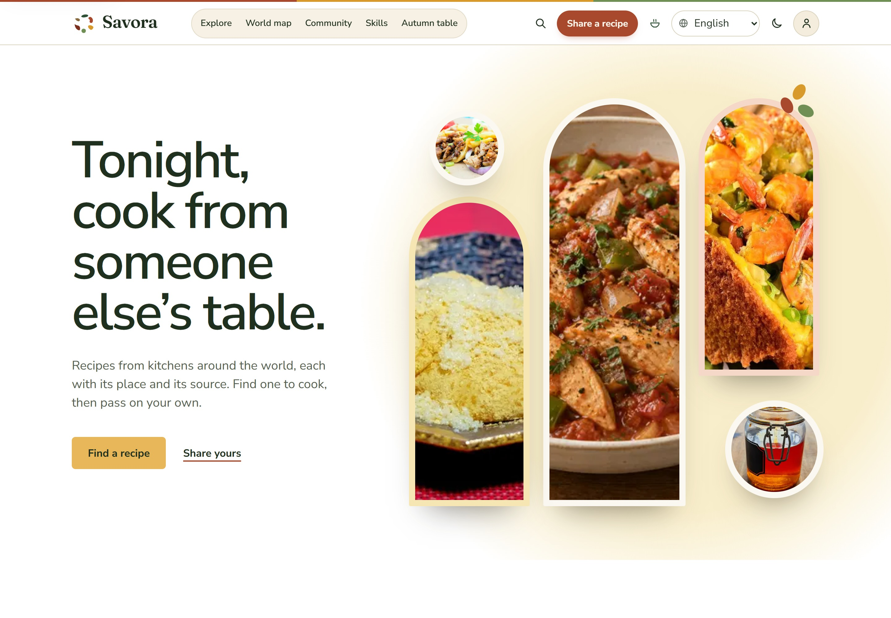
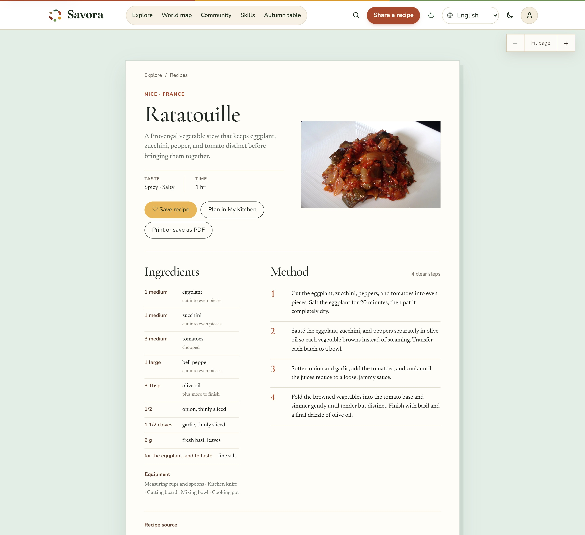
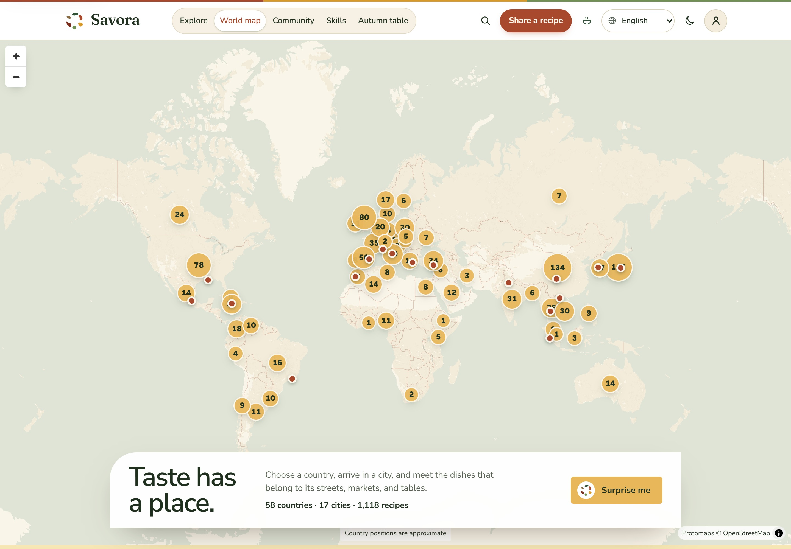
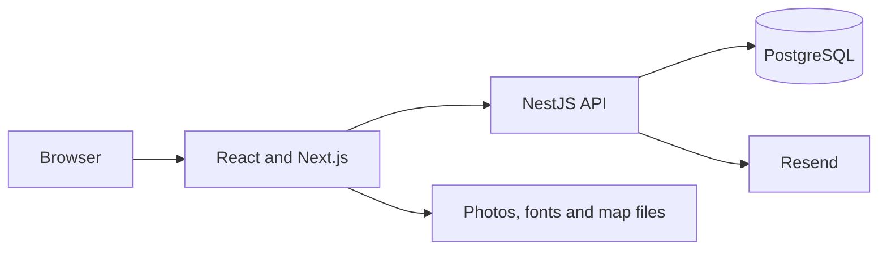

<p align="center">
  
</p>

<h1 align="center">Savora</h1>

<p align="center"><strong>Recipes from kitchens around the world, each with its place and its source.</strong></p>

<p align="center">
  <a href="https://cookwsavora.com/">Visit Savora</a> ·
  <a href="#features">Features</a> ·
  <a href="#technology">Technology</a> ·
  <a href="#recipe-selection">Recipe selection</a> ·
  <a href="#local-development">Get started</a>
</p>

<p align="center">1,500 published recipes · 6 languages · Desktop, tablet and phone</p>



Savora brings recipe discovery, food geography and everyday kitchen planning into one place. Explore a regional dish, follow its method, save it to your kitchen and share what you learned with other cooks. The catalogue combines international collections with editorial work on ingredients, cooking logic, equipment and translations.

English, 简体中文, 日本語, Français, Italiano and Español are available throughout the experience, alongside light and dark themes.

## Features

| Area | What you can do |
| --- | --- |
| **Explore** | Search the published catalogue, browse cuisines and countries, filter recipes and discover related dishes. |
| **World food map** | Explore countries and cities through an interactive map, open local dishes and follow their geographic connections. |
| **Recipe pages** | Read ingredients, ordered methods, equipment, source credits and cooks’ notes. Adjust the reading size, save a recipe, add it to a meal plan or print it as a PDF. Selected editorial dishes also have a guided cooking mode. |
| **My Kitchen** | Keep a recipe collection, organize a weekly meal plan, manage a grocery list and record pantry ingredients. Signed-in cooks can save their kitchen across devices. |
| **Pantry matching** | Enter ingredients you already have and see matching recipes, missing ingredients and supported substitution suggestions. |
| **Community and submissions** | Share a post, reply to other cooks, add a recipe note and prepare a recipe submission with ingredients, method, story and source information. Drafts can be saved and reopened. |
| **Kitchen skills** | Learn practical techniques and equipment use through the illustrated Kitchen Wall. |
| **Food culture** | Read regional and seasonal stories that connect dishes with the places and traditions behind them. |

### A recipe at the table

The Ratatouille page brings the ingredient list, four cooking steps, equipment and source information into a readable recipe sheet.



### Taste has a place

The map opens a geographic view of the catalogue. Country markers lead into regional recipes and city-level stories.



## Technology

| Layer | Frameworks and tools | Role |
| --- | --- | --- |
| Interface | React 19, TypeScript | Interactive recipe, kitchen and community experiences. |
| Web framework | Next.js 16 App Router | Server rendering, route handling, metadata and the production Node application. |
| Development tooling | Vinext, Vite 8 | Local development and the Vite/Cloudflare build path. |
| Styling | CSS Modules, shared design tokens, Tailwind CSS 4 tooling | Responsive layouts, typography, themes and reusable visual styles. |
| Maps | MapLibre GL, PMTiles | Interactive food geography and locally served map assets. |
| Backend | NestJS 11, Express 5, Node.js 22+ | Catalogue queries, accounts, kitchen state, submissions and community APIs. |
| Data | PostgreSQL 17, Drizzle ORM | Recipe versions, accepted translations, provenance, editorial records and account data. |
| Deployment | Docker, Docker Compose, Caddy | Containerized services, persistent storage, HTTPS and static asset delivery. |
| Integrations | Resend, OpenRouter | Account email delivery and optional model-assisted editorial translation. |

The deployed website uses the native Next.js build. The repository also includes the Vinext development workflow. Exact package versions are pinned in the lockfiles.

### Application architecture



The frontend accesses catalogue and account services through server-side API handlers. PostgreSQL stores the recipe catalogue and user workspaces. Static photos and maps are served as public files, with image optimization and browser caching supporting page delivery.

## Recipe selection

The deployed catalogue contains **1,500 published recipes** with English content and five target-language adaptations. Selection prioritizes dishes that a home cook can follow with understandable ingredients, practical equipment and a coherent method. Regional character and a useful range of everyday dishes guide expansion.

### Sources

| Collection | Contribution to the catalogue |
| --- | --- |
| TheMealDB | International recipes and a broad discovery catalogue. |
| HowToCook | Chinese home cooking with ingredient amounts and practical preparation guidance. |
| Wikibooks Cookbook | International dishes, including European home cooking and regional recipes. |
| Japan’s MAFF regional cuisine collection | Japanese regional dishes with place and cultural context. |
| Korean Food Promotion Institute / Hansik | Korean dishes and source-based preparation details. |
| NIH / NHLBI recipe collections | Household recipes from public-health cookbooks. |
| Savora editorial recipes | Curated dishes, recipe adaptations and source-linked corrections. |

Source records retain the provider, original URL, retrieval information and applicable attribution. Original-language names and regional associations help preserve dish identity.

### Editorial criteria

| Criterion | Review standard |
| --- | --- |
| **Suitable for home cooking** | Prefer accessible ingredients, ordinary kitchen equipment and a manageable workflow. Explain a specialist ingredient or tool when the dish needs it. |
| **Complete ingredients** | Match ingredients to the method, preserve source-supported amounts and ranges, distinguish optional garnishes, and resolve conflicting quantities before publication. |
| **Realistic cooking logic** | Check preparation order, heating, mixing, resting and finishing. Ingredients should enter at the correct stage and be used once in the intended quantity. |
| **Useful timing and doneness** | Keep supported time ranges and pair them with observable cues such as tenderness, browning or a set centre. Retain uncertainty when a source gives approximate guidance. |
| **Accurate equipment** | Use familiar, specific names for pans, knives, measuring tools and serving vessels. Check translated equipment against the actual action in the method. |
| **Distinct recipe identity** | Compare source IDs, slugs, English and original-language names against published recipes and drafts. Compare nearby recipe families by their ingredients and method. Accept regional variants when they have a substantive culinary difference. |
| **Natural translations** | Preserve ingredient identity, amounts, units, step order and cooking endpoints. Edit literal phrasing into everyday cooking language, with particular attention to Chinese cooking verbs and equipment names. |
| **Matching imagery** | Prefer a suitable original photograph, then a matching licensed photograph. Review dish identity, visible ingredients, resolution and credits. Label generated illustrations when they are used. |
| **Source and food handling** | Retain attribution and supported geographic context. Review handling, storage, pressure-cooker use and meat or seafood instructions where relevant. |

Recent corrections include moving pizza preparation ahead of topping, aligning cocktail steps with their listed ingredients and replacing mistranslated ingredient or cookware names. These changes enter the catalogue as new recipe revisions.

### From source to published record

1. **Capture the source** with its identity, original content and provenance.
2. **Import a draft** and compare it with existing recipes and related variants.
3. **Review the complete recipe**, including ingredients, method, equipment and imagery.
4. **Adapt and review the languages**, preserving the recipe’s quantities and practical meaning.
5. **Publish a versioned recipe** with its accepted media and attribution, then check the API and rendered page.

### How the Docker data is organized

PostgreSQL runs in a Docker container with a persistent data volume. Its tables store recipe identities, immutable recipe versions, ingredient and method content, place associations, media credits and accepted locale overlays. A recipe correction creates a new revision. Translation overlays are associated with the recipe version they adapt.

The public catalogue queries select published recipes and their current content. Editorial imports and publication use the backend’s catalogue tools. Reviewed changes are checked against a restored database before they are applied, and repeated application of the same publication package reuses its recorded result.

Application images package the frontend and API. The recipe catalogue is maintained in PostgreSQL and populated through the editorial import and publication workflow. A newly migrated database starts with the schema, ready for reviewed catalogue data.

## Local development

### Requirements

- Node.js **22.13 or later** and npm.
- PostgreSQL **17** for the catalogue API.
- Docker for the container build workflow.

### Frontend

```sh
git clone https://github.com/yyuki4975-svg/savora.git
cd savora
npm ci
npm run assets:restore
cp .env.example .env.local
npm run dev
```

Set `SAVORA_API_BASE_URL` in `.env.local` to your catalogue API. The development workflow uses port `5173` by default.

`npm run assets:restore` downloads the photographs and map files listed in `public-assets.json`. It verifies their SHA-256 checksums and reuses files that already match. The manifest keeps the source checkout small while restoring the public media needed by the site.

### Backend and database

Create a PostgreSQL database, then configure the connection in `server/node/.env.local` using the included example.

```sh
cd server/node
npm ci
cp .env.example .env.local
npm run build
node --env-file=.env.local dist/src/cli/migrate.js migrate --apply
node --env-file=.env.local dist/src/main.js
```

The API listens on `http://localhost:5094` by default. Set `SAVORA_DATABASE_URL` to your database connection and `SAVORA_ENVIRONMENT=Development` for local development. Catalogue records are loaded separately through the editorial import tools in `server/node/src/cli`.

| Local endpoint | Purpose |
| --- | --- |
| `/health/live` | Process health. |
| `/health/ready` | Database connectivity. |
| `/v1/recipes?locale=en` | Published recipe list. |
| `/v1/recipes/ratatouille?locale=en` | A published recipe’s detail, after catalogue data is loaded. |
| `/openapi/v1.json` | API contract in the development environment. |

Account, email and translation features have additional configuration switches in their respective services. Set the account API URL and web origin when enabling the local account workflow with `npm run dev:accounts`.

## Docker

Build the production frontend image from the repository root.

```sh
docker build -f server/deploy/Dockerfile.frontend.next -t savora-web .
```

Build the API image using its service directory as the context.

```sh
docker build -t savora-api ./server/node
```

| Service | Container port | Main configuration |
| --- | --- | --- |
| Web | `3000` | Catalogue API URL, account API URL and public web origin. |
| API | `5094` | PostgreSQL connection and enabled application features. |
| PostgreSQL | `5432` | Database credentials and a persistent data volume. |

The production layout places Caddy in front of the web service, with the API and PostgreSQL on the application network. Docker Compose manages the services and their persistent volumes.

## Repository guide

```text
app/                    Pages, interface components and locale bundles
lib/                    API clients, kitchen logic, geography and media helpers
server/node/src/        NestJS API, domain logic and editorial CLI tools
server/node/migrations/ Versioned PostgreSQL migrations
server/node/database/   Schema definitions and database metadata
server/node/openapi/    API contract
server/deploy/          Native Next.js Docker build configuration
public/                 Icons, photos, maps and media credits
scripts/                Development, asset restoration and dependency tooling
docs/images/            Website screenshots used in this README
```

### Development commands

| Command | Purpose |
| --- | --- |
| `npm run dev` | Start the Vinext development server. |
| `npm run dev:accounts` | Start the local frontend with account API routing. |
| `npm run build` | Build through the Vinext/Vite workflow. |
| `npm run typecheck:web` | Type-check frontend code. |
| `npm --prefix server/node run build` | Compile the backend. |
| `npm run security:audit` | Run dependency checks for both packages. |
| `npm run assets:restore` | Restore public photos and map files. |

## Credits

Recipe pages carry their source and adaptation credits. The image credit files record creators, original files and licences for the photographs used across Savora. Map attribution appears in the map interface. [Media credits](public/images/ATTRIBUTIONS.md)

The screenshots above were captured from the live website on 16 November 2026 at 2880 pixels wide. The Ratatouille photograph is by Benoit5656 and is public domain. [Ratatouille photo source](https://commons.wikimedia.org/wiki/File:Ratatouille-Dish.jpg)

<p align="center"><a href="https://cookwsavora.com/">Explore Savora</a></p>
